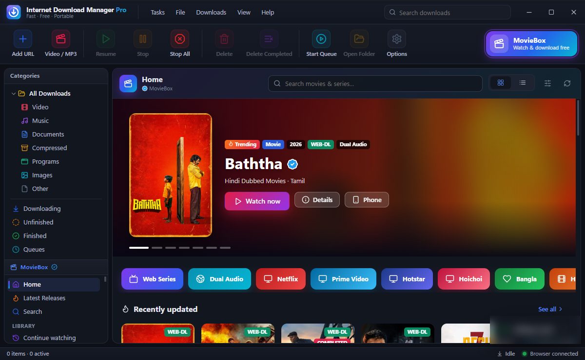
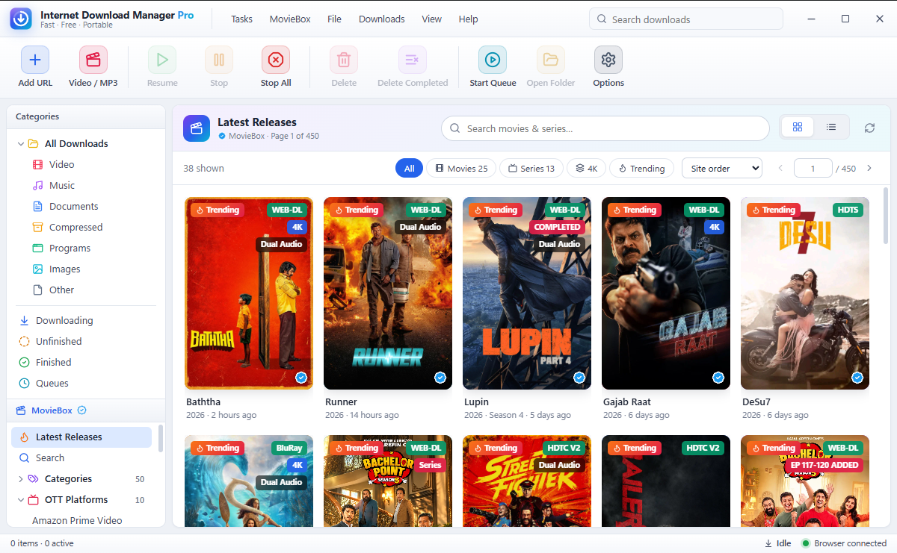
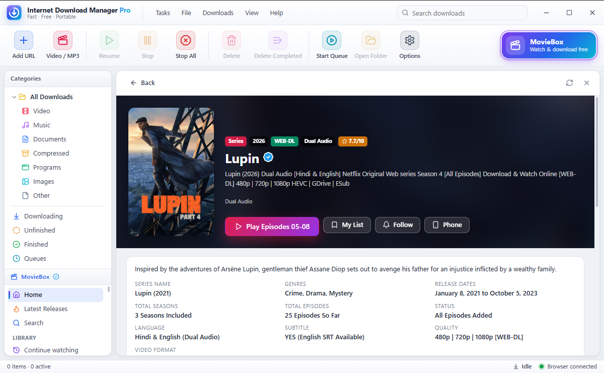
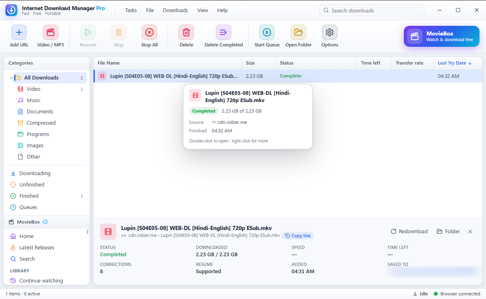
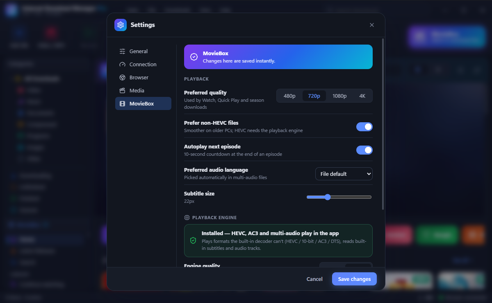

<div align="center">

# ⬇️ IDMPRO — Internet Download Manager Pro

**Fast · Free · Portable download manager for Windows — with MovieBox built in**

Made for users in **Bangladesh 🇧🇩, India 🇮🇳, Pakistan 🇵🇰** and across **Asia** 🌏

[**⬇ Download for Windows (v1.0.0)**](https://github.com/SharpWizard/IDMPRO/releases/latest)

</div>

---

## 📸 Screenshots

<p align="center">
  <br>
  <sub><b>MovieBox Home</b> — featured titles, one-click shortcuts (Web Series, Dual Audio, Netflix, Bangla…) and “Watch now”</sub>
</p>

<table>
  <tr>
    <td width="50%"><br><sub><b>Browse</b> — posters with quality, language and 4K badges; filters by type, language, quality and year</sub></td>
    <td width="50%"><br><sub><b>Title page</b> — details, ▶ Play in the built-in player, My List, Follow new episodes, Watch on phone</sub></td>
  </tr>
  <tr>
    <td width="50%"><br><sub><b>Downloads</b> — fast multi-connection downloads that resume after power cuts, with a clean info card</sub></td>
    <td width="50%"><br><sub><b>Settings · Dark mode</b> — preferred quality (480p for low data), audio language (Hindi / Bangla / English…), subtitles</sub></td>
  </tr>
</table>

## Why IDMPRO?

Internet in much of South Asia is fast one minute and gone the next — mobile data, shared Wi-Fi, load-shedding, night packages. IDMPRO is built for exactly that:

- **🚀 Up to 32 connections per file** — fills your line, even on slow servers.
- **⏯ Pause & resume anything** — survives power cuts, restarts and dropped connections. Your progress is never lost.
- **🌙 Scheduler** — start the queue at night (e.g. 2 AM) to use **night data packages**, and pause it again in the morning.
- **📶 Speed limiter** — keep browsing or calling while big files download.
- **🎬 Video / MP3 downloader** — YouTube and 1000+ sites, from 144p to 4K, or MP3 up to 320 kbps.
- **🧩 Browser button** — Chrome / Edge / Brave: a **“Download this video”** button on YouTube and other players, and automatic capture of browser downloads.
- **📂 Smart folders** — videos, music, documents and programs sorted automatically.
- **💼 Portable** — everything stays next to the app. No ads. No account. Free.

## 🎬 MovieBox — watch & download in the app

- **Bangla, Hindi, Hindi Dubbed, Tamil, Telugu, Malayalam, Kannada, Korean, Dual Audio**, web series, anime and more — browsed in a clean poster grid with search, filters and collections.
- **Built-in player** — subtitles, audio-track switching (e.g. Hindi ⇄ English), speed control, snapshots, picture-in-picture, resume where you stopped, autoplay next episode.
- **Low data? Pick 480p.** Set your preferred quality once in *Settings → MovieBox* and every “Watch” uses it.
- **Save while watching** — downloads in the background and continues from your PC when finished.
- **Offline library** — everything you downloaded plays offline with posters.
- **📱 Watch on your phone** — short link + QR code; or use your phone as a **remote** on the same Wi-Fi.
- **Follow a series** — get a notification when new episodes arrive.

## 📥 Install (Windows 10 / 11, 64-bit)

1. Download **`IDMPRO_1.0.0_x64-setup.exe`** from [Releases](https://github.com/SharpWizard/IDMPRO/releases/latest).
2. Run it. If Windows shows **“Windows protected your PC”**, click **More info → Run anyway**.
   *(This appears for new apps that don't yet have a paid code-signing certificate.)*
3. Open IDMPRO. To add the browser button, click **“Browser ready” / “Install browser extension”** in the bottom bar and follow the 3 steps (about 20 seconds).
4. The playback engine for HEVC / multi-audio movies (~170 MB) is downloaded only when you first need it — handy on limited data.

**Verify your download (optional):** SHA-256 of `IDMPRO_1.0.0_x64-setup.exe`
```
8b40ab0ee3f6caa0972711dc0642bfecee86262fc262dd3ce505ce19526d99c8
```
In PowerShell: `Get-FileHash .\IDMPRO_1.0.0_x64-setup.exe`

## 💡 Tips for South Asian users

| Situation | What to do |
|---|---|
| Mobile data / limited package | Preferences → quality **480p**, and **Prefer non-HEVC files** |
| Night data package | *Settings → Connection → Scheduler* → start at your package time |
| Power cut / Wi-Fi dropped | Nothing — just press **Resume** (or **Start Queue**) later |
| Slow line during the day | *Settings → Connection* → set a **speed limit** |
| Hindi/Bangla audio by default | *Settings → MovieBox → Preferred audio language* |
| Watching on the phone | **Phone** button → scan the QR code |

## ❓ FAQ

**Is it free?** Yes — no ads, no account, no trial.
**Does it need admin rights?** Only the installer; the app runs as a normal user.
**Where are my files?** `Downloads\IDMPRO` by default (change it in Settings).
**The browser button doesn't appear?** Open `chrome://extensions`, click **Reload** on *IDMPRO Integration*, then refresh the page.

## ⚖️ Disclaimer

IDMPRO is a general-purpose download manager. Download and watch only content you have the right to access in your country. The authors are not affiliated with any website the app can open.

---

<div align="center">

Made with ❤️ for South Asia · ঢাকা · दिल्ली · لاہور · Kolkata · Karachi · Chennai · Kathmandu · Colombo

</div>
